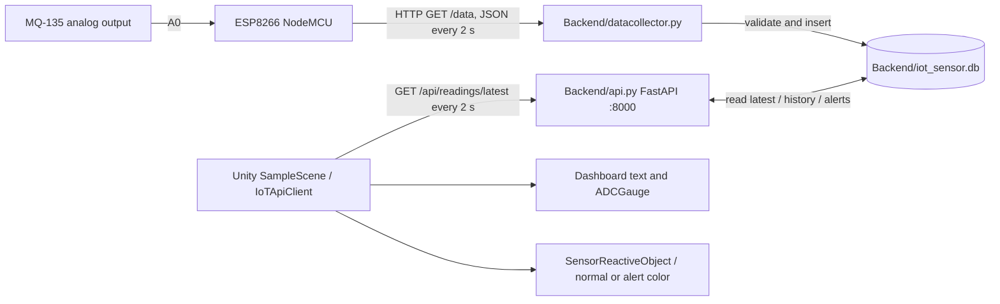
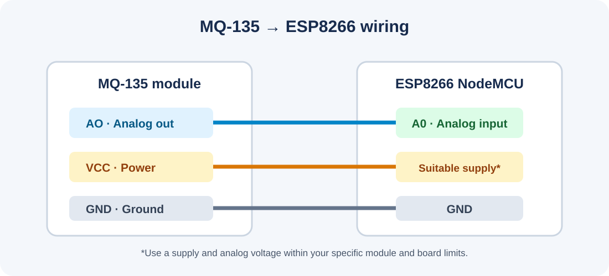

# Iot Spatial Analytics Dashboard

A Unity AR dashboard that reads MQ-135 samples from an ESP8266 through a Python API. It displays the ADC value, connection, gauge, and threshold response.

## Project preview

**Unity scene / WebPreview**


**Live AR output**


## How the pieces connect



The ESP8266 serves samples at `http://<ESP8266_IP>/data` (port 80). The collector validates and stores them in SQLite. FastAPI serves the database on port 8000, and Unity polls the latest reading every 2 seconds to update the dashboard and 3D object.

### Sensor pin connections

The firmware reads the MQ-135 analog output on `A0`.



Check the module and ESP8266 board voltage limits before connecting power or `AO` to `A0`.

### Connection settings

| Link | Setting in this project | Notes |
| --- | --- | --- |
| MQ-135 → ESP8266 | Sensor output → `A0` | The board reads a 0–1023 ADC value every 2 seconds. Check your particular sensor/board voltage limits before wiring. |
| ESP8266 → collector | `http://<ESP8266_IP>/data` | Set `ESP8266_IP` in `Backend/datacollector.py` to the address printed by the board after joining Wi-Fi. Both devices must be on the same reachable network. |
| Collector → SQLite | `Backend/iot_sensor.db` | Run the collector from the `Backend` directory so its relative database path matches the API database beside `api.py`. |
| FastAPI → SQLite | `Backend/iot_sensor.db` | `api.py` resolves the database relative to its own file. Default API URL is `http://127.0.0.1:8000`. |
| Unity → FastAPI | `IoTApiClient.apiUrl` = `http://127.0.0.1:8000/api/readings/latest` | `127.0.0.1` works only when Unity runs on the same computer as FastAPI. For a phone, use the computer's LAN IP, e.g. `http://192.168.1.20:8000/api/readings/latest`, and allow network access through the firewall. |

Copy `Backend/wifi_secrets.example.h` to `Backend/wifi_secrets.h` and set your local Wi-Fi details. The local secrets file and sensor database are Git-ignored. The collector's ESP8266 IP and Unity API URL are also machine/network-specific values.

Before running the AR scene, install Vuforia Engine 11.4.4 from the [Vuforia developer portal](https://developer.vuforia.com/downloads/sdk) through Unity Package Manager, then enter your Vuforia license key in Unity's Vuforia configuration. The SDK binaries are excluded from this repo.

## Run the backend

In two terminals, run the collector and API from the `Backend` directory:

```powershell
cd Backend
python -m pip install fastapi uvicorn requests
python datacollector.py
```

```powershell
cd Backend
python -m uvicorn api:app --host 0.0.0.0 --port 8000
```

Open `http://127.0.0.1:8000/docs` for API docs or `/api/health` to check the database. The latest-reading endpoint returns 404 until the collector saves a sample.

Flash `Backend/espserver.ino` to the ESP8266 after setting its Wi-Fi credentials. Check the serial monitor at 115200 baud for the board's assigned IP, then copy that IP to `ESP8266_IP` in `Backend/datacollector.py`. Keep the collector and API running while using the Unity dashboard.

## Backend endpoints

- `GET /api/health` — database status and sample count.
- `GET /api/readings/latest` — newest stored sample in a `reading` object; consumed by Unity.
- `GET /api/readings?limit=50&min_adc=0&max_adc=1023` — filtered history.
- `GET /api/alerts/config` and `PUT /api/alerts/config` — read/update the API alert threshold (0–1023).
- `GET /api/alerts` and `GET /api/alerts/status` — threshold matched samples and latest status.

The saved scene uses Unity thresholds of **400** (`IoTApiClient`) and **350** (`SensorReactiveObject`). The API alert threshold defaults to **500**; these values are configured separately.

## Unity setup

Open `Assets/Scenes/SampleScene.unity` in **Unity 6.6.7f1**, then press Play. Check the `IOTManager` references and API URL in the Inspector. For a phone, replace `127.0.0.1` with the backend computer's LAN IP and allow port 8000 through the firewall.

## Data format

The ESP8266 `/data` endpoint returns JSON like:

```json
{
  "valid": true,
  "device": "ESP8266",
  "sensor": "MQ-135",
  "sequence": 12,
  "uptime_ms": 24000,
  "mq135_adc": 386
}
```

The collector adds `id` and UTC `collected_at` when storing the sample. FastAPI wraps the latest row as `{"reading": { ... }}`, which matches the `ApiResponse` class in `Assets/IoTApiClient.cs`.

## Repository map

- `Backend/espserver.ino` — Wi-Fi connection, MQ-135 sampling, and ESP8266 HTTP endpoints.
- `Backend/datacollector.py` — polls the board and writes validated readings to SQLite.
- `Backend/api.py` — FastAPI endpoints for health, readings, and threshold alerts.
- `Backend/iot_sensor.db` — SQLite sensor history and API settings.
- `Assets/IoTApiClient.cs` — Unity API polling and dashboard updates.
- `Assets/ADCGauge.cs` — gauge fill and color indicator.
- `Assets/SensorReactiveObject.cs` — threshold based 3D color response.
- `Assets/Scenes/SampleScene.unity` — AR dashboard scene.
- `webpreview.png`, `outputs.jpg` — project and live output previews shown above.
